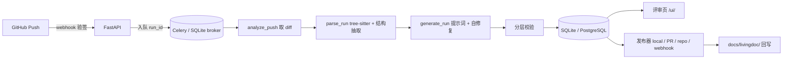

# LivingDoc · 让代码的结构，成为文档的骨架

LivingDoc 是一个**由代码变更自动生成中文技术文档**的系统。它监听 GitHub 的 push，
解析改动涉及的符号（函数、方法、类），再从抽象语法树里抽出真实的继承、实现、组合、
依赖关系与调用链，交给大模型写出 API 参考、类图（PlantUML）和时序图，最后经过规则校验
排版入库，并回写到 GitHub 仓库里。

> 一句话概括：**不给模型"重新理解代码"的机会**——结构事实由 AST 算出来，模型只负责翻译成图和人话。

## 它解决什么问题

| 现象 | 代价 | 根因 |
|---|---|---|
| 架构文档停在半年前 | 新人只能读代码猜边界，老成员不敢删"看起来没用"的方法 | 文档和代码是两份独立的真相源 |
| 让模型"读一遍代码写架构" | 类图是一堆孤立类框，时序图只有一句 `A -> B : process` | 模型看不到调用图与继承关系，只能按名字猜 |
| 文档被人改过又被下次生成覆盖 | 评审意见白提，团队不再信任自动文档 | 缺少人机协同的版本与评审机制 |

LivingDoc 的答案是：**结构事实由解析器算，文字由模型写，判断由规则和人来把关。**

## 核心能力

- **AST 结构抽取**：tree-sitter 解析 Python / Java。除签名与正文外，还抽所属类、基类与
  实现接口、类字段类型、返回类型、调用目标、控制流关键字（if / for / try / …）、是否 async。
- **结构事实驱动的图**：解析结果聚合成 `ClassInfo` / `FunctionInfo` / `Relation`，产出
  "必须画出来的关系边"和"从入口出发的调用链"，既作为提示词里的 ground truth，也作为
  校验器判定"少画一条边"的依据。
- **跨模块上下文**：模块桶里只有本模块的类，`UserService *-- UserRepository` 这种最值钱的边
  会整条消失。因此把全仓库实体名作为 `context` 传进去，并把"声明在别的模块"的类型作为
  外部空类框放行——既画得出关系，又不被判成幻觉。
- **分层校验闸门**：格式规则 → 实体/成员契约 → 结构事实（孤立类、缺关系边、缺返回箭头、
  缺 alt/loop、深层调用链断掉）。不达标就带诊断重新生成，最多三轮。
- **自动修复**：校验诊断被翻译成中文修复指令；输出被 token 上限截断时自动抬高预算，
  并切换到"画小一点"的修复策略。
- **多渠道发布**：本地知识库（Markdown）、GitHub PR 评论、GitHub 仓库回写（分支 + PR 或
  直推 main）、外部知识库 webhook。
- **人机协同评审**：Web 评审页支持查看 AI 草稿、行级 diff、接受/驳回、手工编辑；文档带
  版本号与 `current_revision`，人改过的内容不会被静默覆盖。

## 系统架构



| 层 | 职责 | 代码 |
|---|---|---|
| 入口层 | Webhook 验签、路由、静态页 | `app/main.py`、`app/security.py`、`app/api/review.py` |
| 编排层 | 三段式流水线、幂等、状态机 | `app/tasks.py`、`app/pipeline.py`、`app/dedupe.py` |
| 解析层 | tree-sitter 抽取、符号 diff、结构聚合 | `app/parsers/` |
| 生成层 | 提示词、自修复循环、校验器 | `app/ai/` |
| 存储与发布 | SQLAlchemy 存储、知识库、GitHub 回写 | `app/store.py`、`app/publishers/` |

## 一次 push 的处理流程

1. **验签入队**：`POST /webhook/github` 用 HMAC-SHA256 校验 `X-Hub-Signature-256`；
   同一 `repo + before + after` 只处理一次，重复投递返回 `duplicate_run`。
2. **analyze_push**：调用 GitHub Compare API 取改动文件列表，超过 `DIFF_MAX_FILES` 直接拒。
3. **parse_run**：按 blob sha 取改动前后的源码，逐文件解析符号并做符号级 diff；同时抽结构
   事实（基类 / 字段 / 调用 / 分支），落盘成 `changes.json` 工件。
4. **generate_run**：按模块生成三类文档。每份文档的提示词里都带结构事实块（必须画的关系、
   调用链、控制流），模型输出后过校验器，不过就带诊断重生成。
5. **发布**：通过的文档入库（`documents` + `document_revisions`），再按 `PUBLISH_TARGETS`
   写本地知识库或回写 GitHub；需要人确认的留在评审页。

## 快速开始

### 本地（SQLite + 进程内队列）

```bash
python -m venv .venv
source .venv/bin/activate          # Windows: .venv\Scripts\activate
pip install -r requirements.txt

cp .env.example .env               # 填入 LLM_API_KEY 等；.env 不会入库
python scripts/init_db.py

# 终端 1：API
uvicorn app.main:app --host 127.0.0.1 --port 8000

# 终端 2：worker（Windows 必须 --pool=threads）
celery -A app.celery_app worker --pool=threads --concurrency=4 -Q analysis --loglevel=info
```

- 评审页 <http://127.0.0.1:8000/ui/>，架构总览页 `/ui/showcase.html`
- OpenAPI 文档 `/docs`，健康检查 `/healthz`

发一条本地 webhook（离线也能跑，`--clone-url` 可指向本地仓库）：

```bash
python scripts/send_test_webhook.py --repo your/name --before <sha1> --after <sha2>
```

> `pip` 因证书问题不可用时，可改用
> `uv pip install --python .venv/Scripts/python.exe -r requirements.txt`。

### Docker 全栈（PostgreSQL + Redis + prefork worker）

```bash
docker compose up -d --build
docker compose logs -f api worker
curl http://127.0.0.1:8000/healthz
```

## 目录结构

```
app/
  main.py            FastAPI 入口、webhook 路由、静态页挂载
  security.py        HMAC 验签、时间窗、摘要
  tasks.py           Celery 三段式流水线
  pipeline.py        符号 diff、工件读写、发布编排
  parsers/           tree-sitter 抽取（model / profiles / extractor / differ / structure）
  ai/                prompts / client / self_correct / validator / service
  publishers/        local_kb / github_pr / github_repo / webhook
  static/            评审页与总览页（原生 JS，无构建步骤）
tests/               288 项单元测试与端到端链路测试
scripts/             init_db / 演示 / 评测 / webhook 模拟 / 密钥扫描
docs/                架构文档、分阶段实现记录、交接手册
```

## 质量保证

```bash
python -m pytest tests -q
```

覆盖：符号抽取（Python / Java，含抽象类、重载、装饰器）、结构聚合（继承 / 实现 / 组合 /
依赖、跨模块外部类型、内置类型不误判）、校验规则、提示词契约、自修复轮次、流水线端到端、
发布器、评审 API、并发与幂等。

| 类别 | 代表规则 |
|---|---|
| PlantUML 格式 | E001–E008：缺 `@startuml` / `@enduml`、多余内容、空图、块未闭合、引号不配平、未知箭头 |
| 结构契约 | E013 孤立类、E014 期望关系没画、E016 调用链断掉、E017 有分支却没有 alt/loop |
| 时序语义 | E009 消息缺冒号、E015 有调用无返回、W009 编造参与者、W010 缺返回箭头、W011 深层边未画（仅提示） |
| Markdown | M001–M005：标题、围栏、占位符、正文过短；W005/M005 覆盖要求 |

## 关键设计

- **结构事实优先**：先算后写。模型拿到的不是"请分析这些代码"，而是"这三条关系必须画、
  这条链必须走、这个函数有 if/for"。
- **关系按最强一条去重**：同一对类同时存在组合与依赖时只要求画组合，避免提示词说
  "一对类一条线"而校验器要求两条线。
- **分层校验**：入口两跳内的边是硬要求（error），更深的边只提示（warning）——一张三十行
  的图装不下整棵调用树，硬要求只会换来三次拒稿。
- **截断即降级**：输出被 token 上限截断时自动抬预算并切到"小图"修复指令，而不是把残缺的
  图直接判死。
- **人改优先**：`manual_edited` 标记 + 版本化 revision，人的修改不会被下一次生成覆盖。

## 配置项

全部配置见 `.env.example`，关键项：

| 变量 | 用途 | 默认 |
|---|---|---|
| `DATABASE_URL` | 持久化 | `sqlite:///var/livingdoc.sqlite` |
| `BROKER_URL` / `RESULT_BACKEND` | 队列 | SQLite broker / DB backend |
| `LLM_API_KEY` / `LLM_BASE_URL` / `LLM_MODEL` | OpenAI 兼容端点 | 空 / `https://api.deepseek.com` / `deepseek-chat` |
| `GITHUB_WEBHOOK_SECRET` | webhook 验签 | 需与仓库设置一致 |
| `GITHUB_TOKEN` | 读私有仓库、回写文档 | 空（只读公开仓库） |
| `PUBLISH_TARGETS` | 发布渠道（逗号分隔） | `local_wiki` |
| `GITHUB_DOCS_BRANCH` / `GITHUB_DOCS_DIR` / `GITHUB_DOCS_OPEN_PR` | 文档回写位置 | `livingdoc/docs` / `docs/livingdoc` / `true` |
| `PIPELINE_ENABLED` | 是否自动入队 | `true`（测试里 `false`） |

## 安全说明

- **`.env` 不入库**：`.gitignore` 已排除 `.env`、`var/`、`*.sqlite`；仓库里只保留
  `.env.example`（密钥字段留空）。克隆后请自行复制并填写。
- **密钥只走环境变量**：`docker-compose.yml` 用 `${GITHUB_TOKEN:-}`、`${LLM_API_KEY:-}` 注入，
  没有硬编码；`POSTGRES_PASSWORD: livingdoc` 仅为本地开发凭据，部署请替换。
- **入库前自查**：`python scripts/scan_secrets.py .` 会扫描 `ghp_`、`github_pat_`、`sk-`、
  `LTAI`、`AKIA`、私钥头等模式，命中即返回非零。
- 若曾把 token 写进过提交历史，请直接到 GitHub 撤销该 token——重写历史不能补救已泄露的凭据。

## 文档索引

- [文档总览](docs/README.md)
- [架构总览](docs/architecture/00-overview.md) · [数据流](docs/architecture/data-flow.mmd) ·
  [ERD](docs/architecture/erd.mmd) · [一次分析时序](docs/architecture/sequence-analyze.mmd)
- [API 契约](docs/architecture/api.md) · [数据库设计](docs/architecture/database.md) ·
  [关键决策 ADR](docs/architecture/decisions.md)
- [分阶段实现记录](docs/02-phase2-skeleton.md)（02–08）
- [交接手册](docs/HANDOFF.md)：当前状态、雷区清单、下一轮开工顺序

## 状态与边界

已跑通真实链路：Python 仓库的 push 解析、三类文档生成、结构感知的类图与时序图、校验自修复、
本地知识库与 GitHub 回写、评审页。

已知边界：Java 支持依赖 tree-sitter-java 的语法节点，目前按常见 Maven 写法验证；超大改动
（数千文件）会触发文件数上限而拒绝处理；PlantUML 本地渲染需要 JRE + `plantuml.jar`，缺失时
降级为源码渲染（`render_ok=false`，不影响文档本身）。